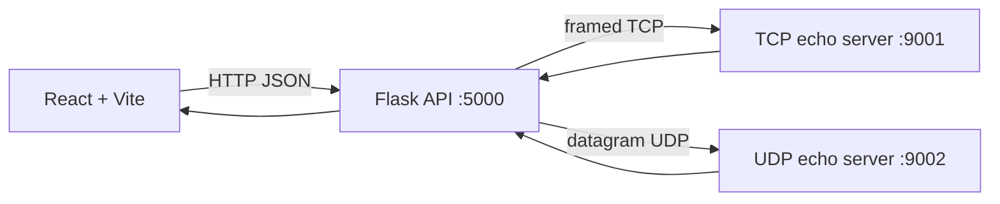

# PacketLab — TCP/UDP Communication Studio

PacketLab is a small, explainable computer-networks lab. It sends real UTF-8
messages through Python TCP and UDP sockets, then displays the server response,
application payload sizes, and measured round-trip time in a React interface.

## Architecture



The TCP client uses a four-byte network-order length prefix, so it does not
assume one `recv()` call contains a complete message. UDP sends one datagram
and waits for one bounded-time response. The displayed byte values are
application payload bytes, not complete IP packets or Ethernet frames.

## Project structure

```text
backend/
  app.py             Flask API and socket-server lifecycle
  tcp_server.py      Framed TCP echo server
  udp_server.py      UDP echo server
  socket_client.py   TCP/UDP clients and measurements
  tests/             API and socket integration tests
frontend/
  src/               React application and responsive styling
requirements.txt
```

## Requirements and setup

Python 3.10+ and Node.js 18+ are recommended.

### Backend

```bash
python -m venv .venv
source .venv/bin/activate                 # Windows: .venv\Scripts\activate
python -m pip install -r requirements.txt
python -m backend.app
```

The API listens on `127.0.0.1:5000`; TCP listens on `127.0.0.1:9001` and UDP
on `127.0.0.1:9002`. Ports and hosts can be changed with
`PACKETLAB_TCP_PORT`, `PACKETLAB_UDP_PORT`, `PACKETLAB_TCP_HOST`, and
`PACKETLAB_UDP_HOST`.

### Frontend

```bash
cd frontend
npm install
npm run dev
```

Open the Vite URL (normally `http://localhost:5173`). To use a different API
URL, set `VITE_API_URL` before starting Vite.

## API

`GET /api/health` reports backend, TCP, and UDP availability. `POST /api/send`
accepts:

```json
{"protocol":"TCP","message":"Hello from PacketLab","timeout":2}
```

`POST /api/compare` accepts the same message and independently attempts both
transports. Both endpoints reject empty messages, invalid protocols, malformed
JSON, and UTF-8 messages larger than 4096 bytes. Requests have a finite
timeout. Error responses never expose a Python traceback.

## Testing

```bash
python -m pytest backend/tests -q
```

The tests cover API validation, bounded unavailable-server behavior, real TCP
framing, and real UDP datagram round trips. The comparison page keeps each
transport result independently, so one timeout does not hide the other result.

## Demonstration guide

1. Start the backend and frontend.
2. Confirm the header shows the API as healthy.
3. Open **Message lab**, send a Unicode message over TCP, and inspect the
   response, latency, and application byte counts.
4. Repeat over UDP.
5. Open **Compare** to send the same text independently through both protocols.
6. Open **History** to filter, search, inspect, or clear the latest 20 attempts.
7. Use **Protocol explorer** to review connection, ordering, delivery, and
   retransmission differences.

## Two-device Remote Device Lab

The **Remote device lab** page is isolated from the local Message lab and
Compare workflows. Run PacketLab on both devices connected to the same private
LAN:

1. On the server device, open the page, choose **Become server**, select TCP
   only or UDP only, and start the listener.
2. Share the displayed private LAN IPv4 address with the other device.
3. Allow TCP `9101` and UDP `9102` through the server device firewall.
4. On the client device, open the same page, choose **Become client**, enter
   the server IP, choose TCP and click **Connect**, or choose UDP and click
   **Contact**.
5. TCP receives the server welcome immediately after connection. UDP sends a
   registration datagram first and receives the server welcome response.
6. Send additional messages over the established session.
7. For UDP, the server can host a message and optional small file. A client
   contact sends one datagram and receives the hosted payload immediately;
   no UDP session is created. Files are limited to 44,000 bytes so the JSON
   response fits in one UDP datagram.
8. For TCP, the server can send messages to the connected client at any time,
   and both sides see the conversation history. TCP is the chat mode; UDP is
   the one-shot transfer mode.

Both devices run their own Flask backend. The browser talks to its local
backend over HTTP; the Python backend performs the actual cross-device TCP or
UDP socket communication. Remote TCP supports messages in both directions over
the persistent socket, including after an idle period, while UDP remains a
registered request-response flow.
The remote API accepts only private or loopback IPv4 addresses, not arbitrary
public destinations.

## Technical limitations

Round-trip time is a local application measurement and includes TCP connection
setup for each TCP request. It is not a universal speed ranking. The app does
not capture raw packets, so its TCP handshake/teardown explanation is
conceptual; it does not claim to observe SYN, ACK, FIN flags, retransmissions,
or packet loss. UDP echo success demonstrates that this datagram received a
response, not that UDP guarantees delivery.

## Future enhancements

Packet capture with an explicit permission boundary, configurable message
framing demonstrations, persisted history, multiple controlled lab hosts, and
optional packet-loss experiments could be added without changing the core API.
